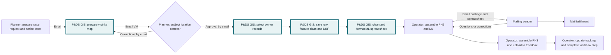
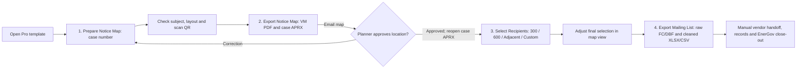

# Process maps

Read left to right. Bold outlines mark **P&DS GIS** work. The maps show operational movement, not automatic code integrations.

## Documented manual process

Operator ownership for the last handoffs requires team confirmation. Fulfillment is performed by the vendor, not the GIS code. The historical board-secretary intake variation is omitted from the main path until clarified.

## Current Pro toolbox

## Deployed web steps and intended manual handoff

```mermaid
flowchart LR
  W[Planner opens public notice web app] --> Q[Search case and confirm subject location]
  Q --> VM[Generate location-map PDF with QR]
  VM --> QR[TEST QR and confirm correct case]
  QR --> B[Choose 300 / 600 / Adjacent / Custom]
  B --> S[Run and adjust recipient selection]
  S --> ML[Download cleaned mailing CSV]
  ML --> V[Planner sends package to mailing vendor]
  V --> E[Complete records upload and close out in EnerGov]
```

The app implements search, location PDF/QR, selection adjustment and cleaned CSV generation; deployed version 9 was reconciled November 12, 2026. Ownership of the subsequent manual handoff still requires agreement. Vendor email, official records storage, mailing-list PDF and EnerGov close-out are not wired into the app. FBC is unsupported. P&DS GIS maintains the tool and source integrations. See current-behavior.md and backlog.md for implementation boundaries.
